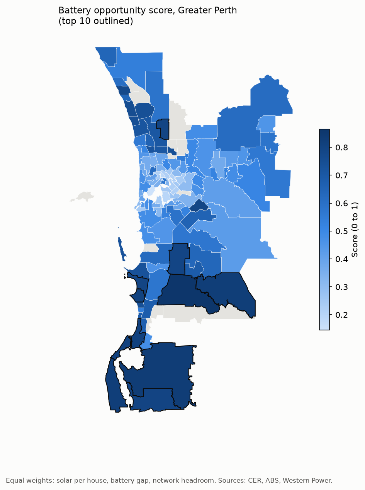

# Perth Solar Grid

Where in Perth would the next home batteries do the most good?

Perth's rooftops hold 3.2 GW of solar. At midday that pushes demand on the South West Interconnected System (SWIS) towards the 300 MW floor AEMO needs for secure operation, and AEMO forecasts minimum demand falling from 319 MW in 2025-26 to 193 MW by 2028-29. Batteries soak up that midday surplus and release it in the evening peak. This project ranks Greater Perth postcodes by how much a battery is likely to help there.

**[Open the interactive map](https://jackw1411.github.io/perth-solar-grid/map/)** · [Write-up](docs/WRITEUP.md) · [Method and results](docs/STAGE3_SCORE.md)



## How the score works

Each postcode gets three percentile ranks, averaged with equal weights:

| Component | Measures | Source |
|---|---|---|
| Solar | Solar systems per 100 houses | Clean Energy Regulator, ABS Census 2021 |
| Battery gap | Batteries installed since July 2025 per 100 solar systems, reversed | Clean Energy Regulator |
| Network | Forecast spare capacity at the local substation in 2028, reversed | Western Power |

The ranking is tested under 36 other weightings and checked against the sites where Western Power is already paying for network support. The results and their limits are in [docs/STAGE3_SCORE.md](docs/STAGE3_SCORE.md).

## Run it

Python 3.12. Raw data is not in the repo; [docs/DATA_SOURCES.md](docs/DATA_SOURCES.md) lists every download and where it goes under `data/raw/`.

```
python -m venv .venv
.venv\Scripts\activate
pip install -r requirements.txt

python src/build_baseline.py   # join CER and Census data to Perth postcodes
python src/fetch_inom.py       # dated snapshot of Western Power support sites
python src/score.py            # score, sensitivity check, validation
python src/export_web_map.py   # docs/map/index.html
```

## Status

Stages 0 to 3 are done. Rooftop solar detection from imagery (Stages 4 and 5) is on hold because there is no free high-resolution imagery of Perth (decision D8). See [docs/SCOPE.md](docs/SCOPE.md).

## Docs

- [Scope](docs/SCOPE.md): stages and risks
- [Decisions](docs/DECISIONS.md): what was decided and why
- [Data sources](docs/DATA_SOURCES.md): every source, with licence and known limits
- [Gotchas](docs/GOTCHAS.md): things that cost time

## Licence

Code is MIT licensed (see [LICENSE](LICENSE)). Third-party data keeps its own licence, listed in [docs/DATA_SOURCES.md](docs/DATA_SOURCES.md). No raw data is committed to this repo.
